**Hi, I'm Hashan.** I run [HEXHAD](https://hexhad.github.io/), a mobile-first app studio from Sri Lanka.

  
  
  
  
  
  

### Apps

  
  
  
  
  
  
  
  
  

### Open source

- [`@hexhad/react-native-global-modal`](https://github.com/hexhad/react-native-global-modal) Global alerts with priority queues
- [`react-native-nitro-otp-verify`](https://github.com/hexhad/react-native-nitro-otp-verify) Automatic SMS OTP reading on Android
- [`react-native-nitro-sms-user-consent`](https://github.com/hexhad/react-native-nitro-sms-user-consent) One-tap OTP with SMS User Consent
- [`@hexhad/react-utils`](https://github.com/hexhad/react-utils) Typed utilities for React and React Native

Have an app in mind? [hashandharmapriya@gmail.com](mailto:hashandharmapriya@gmail.com)
